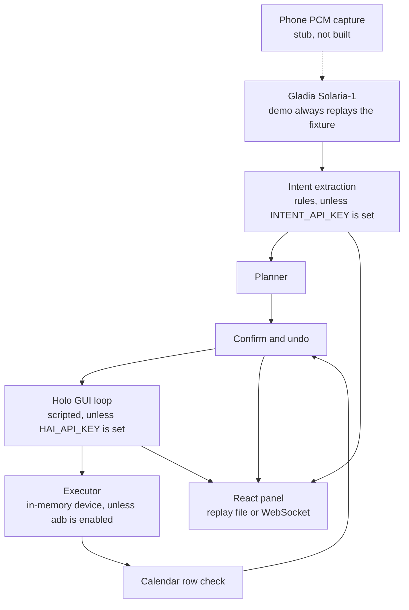
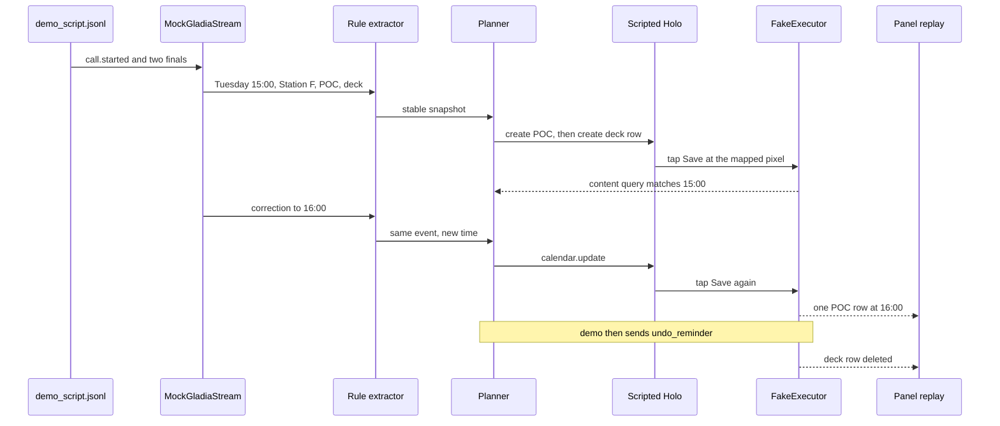

# CallPilot

CallPilot listens to a phone call and turns what was agreed into a calendar event, a reminder, and a short note. The hackathon target is a rooted Android phone: live audio goes to speech-to-text, a planner decides what to write, and a computer-use model taps the screen. H's Agents API has no Android environment, so the click loop is ours and talks to the Holo Models API.

This repository is the team project for the [H Company × 42AI Computer Use Agents Hackathon](https://luma.com/hz9db5u9) (7–8 November 2026, Paris). Four people, about 36 hours on site.

What runs today is a laptop mock of that pipeline. It does not place a real call, does not open a phone, and does not call Gladia or Holo unless you set keys and opt out of the mock.

Chinese product and build notes: [docs/PRD.md](docs/PRD.md), [docs/DEV_PLAN.md](docs/DEV_PLAN.md).

## Problem

On a call, people agree a time and a follow-up. After they hang up they still have to open the calendar, a notes app, and a reminder and type it in. Transcription products stop at a summary. Several of the apps we care about have no API we can call, so the plan is to drive the phone UI.

## Demo scenario

The script, in `laptop/fixtures/demo_script.jsonl`:

1. "On se voit mardi prochain à 15h à Station F pour le POC… and can you send me the deck before Thursday?"
2. "Ah non, plutôt 16h."

Resolved against the hackathon weekend in `Europe/Paris`, that is a POC event on Tuesday 10 November 2026 at 16:00 at Station F, a second calendar row titled "Send the deck" on Thursday 12 November 2026 at 09:00, and a one-line note. The mock then deletes the deck row.

The note is text on the confirm card. Nothing writes a notes app. The deck "reminder" is a second calendar row, not a clock alarm.

## What is implemented

| Piece | In this repo |
| --- | --- |
| Replay of the script as transcript events | Yes. `MockGladiaStream` reads the fixture. It checks PCM frame framing and then ignores the audio bytes. |
| Slot extraction and the 15:00 → 16:00 correction | Yes, with a rule extractor aimed at this script. A live JSON model is optional and unused by the demo. |
| Planner | Yes. It emits calendar create/update, reminder create, and a panel-only note, each with an inverse action. |
| GUI loop and 0–1000 → pixel mapping | Yes. The demo uses a two-step script: click Save, then `answer`. |
| Calendar check | Yes, against an in-memory list formatted like `adb shell content query` output. |
| Confirm card and undo of the deck row | Yes. The demo applies `undo_reminder` itself after hangup. |
| React panel | Yes. It replays `laptop/fixtures/panel_replay.jsonl`. It can also listen on a WebSocket. It does not send decisions back. |
| Phone capture app | No. `phone/app/AudioPump.kt` is an interface comment, not a Gradle project. |
| Live Gladia audio streaming | No. With `GLADIA_API_KEY`, the client can `POST /v2/live` only. |
| Live Holo clicks on a device | No device. With `HAI_API_KEY` and without `CALLPILOT_FORCE_MOCK`, the demo does call `LiveHolo`. Taps still go to `FakeExecutor`. |
| Real `adb` / `su` | Command strings are built. They run only if `CALLPILOT_EXECUTOR=adb`. Updating an existing on-device event is not implemented; the fake executor replaces a row with the same title. |

## Architecture

Solid arrows are what `python3 -m orchestrator.demo` runs. The phone and the live APIs are not on that path.



The mock call, in order:



## Tech stack

- Laptop: Python 3.11+, Pydantic 2.14, pytest. Entry points live under `laptop/`.
- Panel: React 18, TypeScript, Vite. Tests use Vitest.
- Speech-to-text, when a key is set: [Gladia](https://docs.gladia.io/chapters/live-stt/quickstart) live API, model `solaria-1`. Streaming audio is not connected.
- GUI model, when a key is set: Holo via `https://api.hcompany.ai/v1/` (`holo4-35b-a3b` by default). The demo does not send screenshots there.
- Device side, not built yet: rooted Android, `adb`, `su`, `screencap`, calendar `content` URI. See [phone/README.md](phone/README.md).

H Company and Gladia are the two sponsors this code is written against. The event also lists Cognition/Devin, Linkup, and Stripe. This repository does not call them. Stripe is out of scope for the product. Linkup address lookup and any Devin-written sample are not in the tree.

## Repo layout

```text
docs/            Chinese PRD and development plan
laptop/          Python pipeline, contracts, fixtures, tests
  contracts/     Pydantic models and schema/v1.json
  stt/           PCM frames, Gladia init, mock stream
  intent/        Rule extractor and reducer
  planner/       Snapshot to actions
  confirm/       Confirm card and undo
  gui/           Coordinate scaling and Holo client
  verify/        Calendar row match
  executor/      FakeExecutor and adb command builder
  orchestrator/  demo, pipeline, WebSocket replay
  fixtures/      Script and recorded panel events
  tests/
panel/           React panel
phone/           Stub and wiring notes
demo/            Placeholder for slides. Empty of media.
```

## Quickstart

From a clean checkout, no keys and no phone:

```bash
cd laptop
python3 -m pip install -e ".[dev]"
python3 -m pytest
python3 -m orchestrator.demo
```

`orchestrator.demo` exits 0 and prints `[ok] POC at 16:00, reminder undone`.

Panel:

```bash
cd panel
npm ci
npm test
npm run dev
```

Open the page and press "回放剧本". The button label is still Chinese.

To push the same events over a socket instead of only the file:

```bash
cd laptop
python3 -m orchestrator.serve
```

The panel listens on `ws://127.0.0.1:8765/events` unless `VITE_WS_URL` is set. CI (`.github/workflows/ci.yml`) runs pytest, the demo, and the panel test and build.

## Configuration

Unset means mock. `CALLPILOT_FORCE_MOCK=1` forces the mock even when keys are present.

| Variable | Default | Effect |
| --- | --- | --- |
| `CALLPILOT_FORCE_MOCK` | unset | `1` keeps Gladia, Holo, and the intent model on their mocks. |
| `GLADIA_API_KEY` | unset | If set, `GladiaClient.create_session` can `POST /v2/live`. No audio is sent. |
| `GLADIA_BASE_URL` | `https://api.gladia.io` | Host for that POST. |
| `HAI_API_KEY` | unset | If set, and `CALLPILOT_FORCE_MOCK` is not `1`, `orchestrator.demo` uses `LiveHolo` and posts screenshots. Taps still hit the fake device. |
| `CALLPILOT_HOLO_BASE_URL` | `https://api.hcompany.ai/v1` | Holo base URL. |
| `CALLPILOT_MODEL` | `holo4-35b-a3b` | Model name for `LiveHolo`. |
| `INTENT_API_KEY` | unset | If set, and `CALLPILOT_FORCE_MOCK` is not `1`, the demo uses the live extractor instead of the rules. |
| `INTENT_BASE_URL` | `https://api.openai.com/v1` | Host for that API. |
| `INTENT_MODEL` | `gpt-4.1-mini` | Model name for the live extractor. |
| `CALLPILOT_EXECUTOR` | unset | `adb` is the only value that runs `adb`. Anything else, including unset, uses `FakeExecutor`. |
| `ANDROID_SERIAL` | unset | Passed to `adb -s` when the adb executor runs. |
| `VITE_WS_URL` | `ws://127.0.0.1:8765/events` | Panel socket. Build-time variable. |

`orchestrator.demo` always constructs `FakeExecutor` and the env-selected extractor and Holo client. With no keys, both are mocks. It does not switch to adb.

## Mock mode and what is still missing

Mock mode covers the script above: both utterances, three GUI save clicks (POC, deck row, then the time change), a confirm card, and deletion of the deck row. Tests lock the recorded panel log to that run.

Still needs a phone, or is only a client:

- Capturing `VOICE_CALL` and streaming PCM to the laptop (`adb forward tcp:8770`).
- Running taps, `screencap`, calendar INSERT, query, and delete on a device.
- Gladia WebSocket audio, and Holo choosing clicks from a real screenshot.
- A notes app and a system alarm. Both are out of the mock.
- Slides, a backup recording, and measured on-device latency. The mock's click count is not a device measurement.

## Team

Planned split, from the development plan:

| Person | Area |
| --- | --- |
| Simon | Android audio, root executor, device |
| Teammate A | Holo loop, coordinate scaling, calendar check |
| Teammate B | STT, intent, planner, confirm/undo, orchestrator |
| Teammate C | Panel, slides, backup video |

The phone and the adb execution path are still the stubs described above. Slide and video work has not started.

## Docs

- [docs/PRD.md](docs/PRD.md) — problem, priorities, demo script, privacy, open assumptions (Chinese)
- [docs/DEV_PLAN.md](docs/DEV_PLAN.md) — modules, contracts, schedule, risks (Chinese)
- [laptop/README.md](laptop/README.md) — shorter run notes (Chinese)
- [phone/README.md](phone/README.md) — PCM frame and adb wiring, for when a device is available (Chinese)
