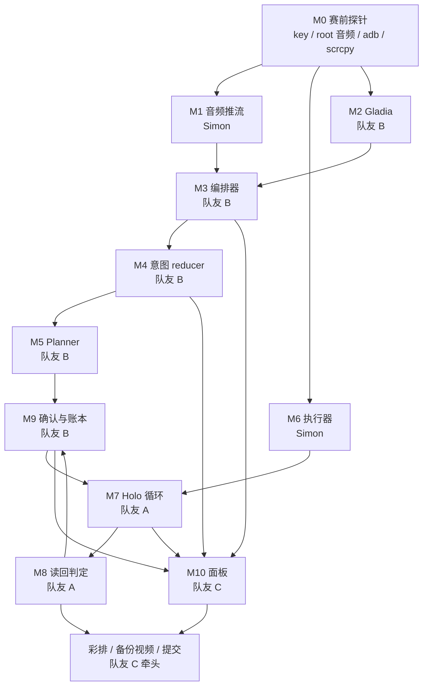
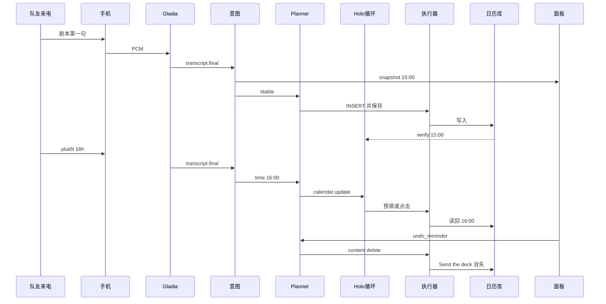

# CallPilot 开发计划（黑客松 36 小时）

本文把 [PRD.md](PRD.md) 拆成可以并行开工的模块。产品行为以 PRD 为准；消息字段以本文 [接口契约](#contracts) 为准。两边冲突时，先改文档再写代码。

赛前不写产品代码（活动规则尚未核实，见 PRD 假设表）。本文的目录只是周六上午要建的仓库布局。JSON 示例可以直接抄进测试 fixture。

四人分工对应方案原文：

| 人 | 方案角色 | 目录 | 周六主责 |
| --- | --- | --- | --- |
| Simon | Android 与音频 | `phone/`、`laptop/executor/` | 特权推流、adb/root 原语、真机 |
| 队友 A | Agent 循环 | `laptop/gui/`、`laptop/verify/` | Holo 循环、坐标换算、重试、读回判定 |
| 队友 B | 意图与 planner | `laptop/stt/`、`laptop/intent/`、`laptop/planner/`、`laptop/confirm/`、`laptop/orchestrator/` | Gladia、槽位、计划、确认/撤销、把各模块接上 |
| 队友 C | 面板与 pitch | `panel/`、`demo/` | React 面板、幻灯片、备份视频、社交帖 |

一个人参赛时的砍法（与方案一致）：不要面板，只留 scrcpy；不做 Linkup 和本地模型。主线只留「通话 → 日历事件 → 改口 → 确认」。

## 建议的仓库布局

周六再建这些目录，现在不要加代码：

```text
phone/app/                 # Kotlin。PCM 推流、录音指示
laptop/
  orchestrator/            # Python asyncio 入口。只做接线
  stt/                     # Gladia 会话
  intent/                  # patch reducer，纯函数
  planner/                 # 快照 → 动作计划，纯函数
  confirm/                 # 确认卡状态与动作账本
  gui/                     # Holo 循环
  verify/                  # 期望槽位 vs 日历行，纯函数
  executor/                # adb / su 的薄封装
  contracts/               # 从本文抄出的 JSON Schema
  fixtures/                # 台词、截图、Holo 回放
  tests/
panel/                     # Vite + React + TypeScript
demo/                      # 幻灯片提纲、备份视频。禁止放 key
```

规则：每人只写自己的目录。跨模块只通过下面的消息。集成改动集中在 `laptop/orchestrator/`，由队友 B 合并。`contracts/` 在周六 10:30 冻结，之后改字段要同时改 fixture 和本文。

环境变量：

| 变量 | 用途 |
| --- | --- |
| `HAI_API_KEY` | H Models API，`base_url=https://api.hcompany.ai/v1/` |
| `GLADIA_API_KEY` | 请求头 `x-gladia-key`，`POST https://api.gladia.io/v2/live` |
| `CALLPILOT_MODEL` | 演示用 `holo4-35b-a3b` |
| `CALLPILOT_MODEL_HARD` | `holo4-27b`，只在 P1 升级难步骤 |
| `INTENT_BASE_URL` / `INTENT_API_KEY` / `INTENT_MODEL` | 文本槽位模型，与 Holo 分开 |
| `ANDROID_SERIAL` | `adb -s` |

## 依赖图



实线是数据依赖。M1、M2、M4、M6、M7、M10 都可以用 fixture 并行，不必等真机通话。

## 关键路径

决定演示能不能成立的顺序：

1. 周五：演示机能否录到通话声（最好是双方）。这条不过，周六上午就改走免提麦克风或备份剧本，而不是继续磨特权 App。
2. 周六 13:00：现场通话的字出现在面板上。
3. 周六 16:30：一条文字指令经 INSERT 预填 + 执行器，在日历库里查出事件。
4. 周六 20:30：台词 fixture 自动变成草稿，并触发第 3 步。
5. 周六 24:00：改口把 15:00 改成 16:00，撤销能删掉提醒，读回一致。
6. 周日 10:00：完整脚本连续成功 3 次。
7. 周日 12:00：同脚本视频已导出，延迟表已填。
8. 周日 14:00：提交。15:45 决赛 pitch。

Holo 循环和意图 reducer 不在音频探针的下游，周六中午就可以用截图 fixture 和台词 fixture 做完。真正的汇合点是周六 16:30 之后的编排器。

## 总排期

时间用 `Europe/Paris`。块边界与方案一致，块内拆到大约一小时。00:00 必须停手睡觉。

### 赛前（不写产品代码）

| 时间 | 做什么 | 完成标准 |
| --- | --- | --- |
| 11/5 周四 | 开通 H 与 Gladia。给 Holo 充值。跑通各自官方示例。注意当天另有伊泽尔黑客松线上说明会，钟点自行核对 | 付费模型能返回一次 `click`；Gladia 官方示例能出 final。额度页能看到余额 |
| 11/6 周五 | 真机音频、`input tap`、`screencap`、scrcpy、日历 INSERT 与 `content query` | 设备档案填完。通话是否有双方声音有明确结论 |

### 周六 11/7

| 时间 | Simon | 队友 A | 队友 B | 队友 C |
| --- | --- | --- | --- | --- |
| 09:00–10:30 | 签到，确认规则（赛前代码、提交格式、评审）。对照规则改 PRD 假设表。冻结契约 | 同左 | 同左 | 同左。记下社交标签原文 |
| 10:30–11:30 | `phone/` 把麦克风或已探针成功的音源推出 PCM | 执行器客户端 + 坐标单测；用一张日历截图打 Holo | Gladia 吃 `fixtures/tone.wav` 或静音 PCM，打出 `transcript.final` | 面板用 `fixtures/events.jsonl` 画出转写和空槽位 |
| 11:30–13:00 | 把真机流接到笔记本 | 继续执行器：`am start` INSERT | 编排器把 PCM 送给 Gladia，广播转写 | 接上真实转写 WebSocket。**13:00 关卡：现场通话能看见双方或单方文字** |
| 13:00–14:30 | 修推流抖动；标定保存按钮坐标 | 截图 → Holo → `tap` 闭环 | 用 fixture 写 reducer 测试 T1–T6 | 槽位 diff 组件，仍吃 fixture |
| 14:30–16:30 | 配合日历 Intent 的 `am start` 参数 | **文字指令建成日历事件并读回。** 这是 16:30 关卡 | reducer 吃演示台词 fixture | 步骤列表组件，吃 `agent.step` fixture |
| 16:30–18:30 | 修真机上 INSERT 表单的坑 | 把 GUI 循环收成函数：输入 `action.requested`，输出 `action.finished` | 稳定快照发出 `plan.created` | 面板显示计划 |
| 18:30–20:30 | 守着手机 | 接上编排器跑通「一句话 → 草稿事件」 | **20:30 关卡：台词自动生成日历草稿** | 确认卡 UI，按钮先打日志 |
| 20:30–22:30 | 观察改口时的界面 | 改时间的动作（更新已有事件，不新建） | 更正 patch + 反向计划 | 槽位 15:00 → 16:00 的动画或 diff |
| 22:30–24:00 | 设备进入演示态：勿扰、关更新、清测试事件 | 读回失败则回滚 | 确认/撤销接到 `content delete`。**24:00 关卡：改口与撤销都成立** | 挂断按钮。到点停手 |

### 周日 11/8

| 时间 | 一起做什么 | 完成标准 |
| --- | --- | --- |
| 00:00–07:00 | 睡觉，至少 5 小时 | 不把调试拖进凌晨 |
| 07:00–08:30 | 端到端接线，清日历，走一遍脚本 | 日志里四段耗时都有数 |
| 08:30–10:00 | 完整排练至少 3 次 | 连续 3 次成功，或明确改走备份视频 |
| 10:00–12:00 | 录备份视频；把测到的延迟、步数、成功率写进表 | 视频在本地可全屏播放；表上没有空着的「待测」还被当成数字 |
| 12:00–13:30 | 幻灯片、README、社交帖 | 材料齐 |
| 13:30–14:00 | 提交，留 30 分钟余量 | 14:00 前提交完成 |
| 14:00–15:45 | 彩排投屏、USB、热点。15:45 决赛 pitch | 备份视频快捷方式在手 |

## 模块

每个模块都列出功能、技术栈、依赖、能否并行、测试和验收。消息正文见 [接口契约](#contracts)。

### M0 赛前探针

- **功能：** 确认 key、root、音频、点击、截图、日历 URI。产出一份设备档案，不产出产品功能。
- **技术栈：** adb、scrcpy、Holo 与 Gladia 的官方示例、Magisk（若权限探针需要）。
- **依赖：** 两台手机、USB 线、转接头、充电器、已 root 的演示机。
- **并行：** Simon 做手机，任意一人做云端 key。
- **测试：** 探针本身就是测试。每项记录命令和原始输出到自己的笔记，不要把 key 写进仓库。
- **验收：** 设备档案里每一项都是 `ok` 或 `fail`，没有 `untested`。

设备档案：

```json
{
  "v": 1,
  "serial": "",
  "model": "",
  "android_sdk": 0,
  "wm_size": "",
  "wm_density": "",
  "su": "untested",
  "voice_call_capture": "untested",
  "stereo_channels": "untested",
  "local_channel": null,
  "screencap": "untested",
  "scrcpy_with_screencap": "untested",
  "input_tap_ms": null,
  "calendar_uri": "content://com.android.calendar/events",
  "calendar_insert": "untested",
  "save_button_xy": null
}
```

周五命令清单（在演示机上执行，把结论填进档案）：

- `adb devices`、`adb shell su -c id`、`adb shell wm size`、`adb shell wm density`
- `adb exec-out screencap -p > /tmp/screen.png`，确认 PNG 头没有被换行弄坏
- `adb shell su -c input tap X Y`，量从发命令到界面变化的时间
- 安装 priv-app / Magisk 方式的捕获器，拨一通测试电话，确认有没有上行、下行、还是只有一路
- `adb forward tcp:8770 tcp:8770` 之后，笔记本能收到 PCM 帧
- `scrcpy` 走 USB 的同时再抓一张 `screencap`
- 日历：

```text
adb shell content query --uri content://com.android.calendar/events --projection _id:title:dtstart:dtend:eventLocation
adb shell am start -a android.intent.action.INSERT -d content://com.android.calendar/events --el beginTime 1794322800000 --el endTime 1794326400000 --es title POC --es eventLocation "Station F"
```

`CAPTURE_AUDIO_OUTPUT` 是 privileged 权限。`pm grant` 给普通应用通常无效。周五如果授权失败，立刻把 M1 的现场路径改成兜底音源，不要把周六上午耗在签名权限上。

### M1 音频推流

- **负责人：** Simon
- **功能：** 通话期间持续发送 PCM 帧；开始和结束各发一条控制消息；屏幕上有记录指示和开关。
- **技术栈：** Kotlin、`AudioRecord`、`VOICE_CALL`（音源常量 4）。参考 BCR 的特权应用思路，自写推流。帧通过本机 TCP 发出，笔记本用 `adb forward tcp:8770 tcp:8770` 连接。
- **依赖：** M0 的音频结论。Gladia 不在手机上，手机不持有 `GLADIA_API_KEY`。
- **并行：** 可以。笔记本侧用 `laptop/fixtures/pcm_header.json` 描述的假帧开发 M2。M1 用环回文件自测，不必等 Gladia。
- **契约：** 产出二进制帧（见下）。控制消息 `call.started` / `call.ended`。
- **测试：** 单元测试帧头编解码。设备测试：打 10 秒电话，笔记本把 PCM 存成 wav 后能听见。双声道失败时档案标 `channels=1`，下游照常工作。
- **验收：** USB 连接下，通话开始后 2 秒内笔记本收到第一帧；挂断后收到 `call.ended`；指示在采集期间一直可见。

PCM 帧（大端）：

```text
uint32 header_json_bytes
header_json utf-8
uint32 pcm_bytes
pcm bytes
```

```json
{
  "v": 1,
  "type": "audio.frame",
  "call_id": "call_demo",
  "seq": 1,
  "ts_mono_ms": 1200,
  "sample_rate": 48000,
  "channels": 2,
  "encoding": "pcm_s16le",
  "capture": "voice_call"
}
```

`sample_rate` 和 `channels` 按硬件真实值填。重采样到 16000 Hz 由 M2 做。`seq` 从 1 连续递增，断号算传输错误。

音源兜底，按这个顺序，周五就选定，周六不再改：

1. `voice_call` 双声道
2. `voice_call` 单声道
3. VoIP（如 WhatsApp）系统播放捕获
4. 免提 + `MIC`
5. 播放事先同意录好的剧本音频（面板必须显示「剧本音频」）
6. 直接切备份视频

### M2 Gladia 实时转写

- **负责人：** 队友 B。Simon 只保证 PCM 帧。
- **功能：** `POST https://api.gladia.io/v2/live` 创建会话，连接返回的 WebSocket，发送音频，把 Gladia 的 `transcript` 消息映射成内部事件。挂断时发送 `stop_recording`。
- **技术栈：** Python asyncio，`gladiaio-sdk` 或裸 WebSocket 二选一，周六 10:30 定一种。
- **依赖：** `GLADIA_API_KEY`。PCM 帧契约。不依赖真机：fixture wav 就能开发。
- **并行：** 与 M1、M4、M10 并行。
- **契约：** 消费 `audio.frame`。产出 `transcript.partial` 与 `transcript.final`。
- **测试：** 用一段含「mardi prochain à 15h」和英语从句的 fixture wav（周四用自己的声音录，时长 15 秒以内）。断言有 final、文本非空、`utterance_id` 稳定。再用单测把 Gladia 样例 JSON 映射成内部事件。
- **验收：** 剧本第一句在会话里出现至少一条 final；partial 不会被标成 final；`channels=2` 时 `channel` 原样保留。

初始化体（与推流一致后再改 `channels`）：

```json
{
  "model": "solaria-1",
  "encoding": "wav/pcm",
  "sample_rate": 16000,
  "bit_depth": 16,
  "channels": 1,
  "endpointing": 0.05,
  "maximum_duration_without_endpointing": 5,
  "language_config": {
    "languages": ["fr", "en"],
    "code_switching": true
  },
  "messages_config": {
    "receive_partial_transcripts": true,
    "receive_final_transcripts": true
  }
}
```

音频用二进制 WebSocket 帧发送，内容是 16 kHz、16-bit、会话 `channels` 路的 PCM。

### M3 编排器

- **负责人：** 队友 B
- **功能：** 进程内 asyncio 队列加上对外 WebSocket `ws://127.0.0.1:8765/events`。把 M1/M2 接进来，按状态调用 planner、confirm、gui。面板的唯一写入是 `confirm.decision`。
- **技术栈：** Python asyncio。WebSocket 服务用标准库或已选定的小库，10:30 冻结依赖。
- **依赖：** 各模块的纯函数签名。可以先用 mock 对象。
- **并行：** 骨架周六上午就写。业务接入放在 16:30 之后，避免上午互相阻塞。
- **契约：** 广播 [事件信封](#envelope)。不解析业务之外的字段。
- **测试：** 用内存队列回放 `fixtures/demo_script.jsonl`，断言事件顺序：final → snapshot → plan → action → verify → confirm.request。
- **验收：** 面板和单元测试连的是同一个端口和同一套 JSON。编排器里没有日历规则、没有坐标数学。

建议调用顺序：

1. `call.started` 后启动 Gladia 会话。
2. 每条 `transcript.final` 交给 intent，广播新的 `intent.snapshot`。
3. 快照里日历字段变为 `stable` 且相对上一份有变化时，调用 planner。
4. `plan.created` 交给 confirm。P0 在通话中执行日历动作；挂断后发确认卡（见 PRD 范围决定 1）。
5. 执行时发 `action.requested` 给 GUI 循环；循环通过执行器客户端说话。
6. `action.finished` 后做 verify。不一致就重试，仍失败则执行反向计划。
7. `call.ended` 后发 `confirm.request`。

### M4 意图状态机

- **负责人：** 队友 B
- **功能：** 文本模型把一条 final 变成 `intent.patch`。纯函数 reducer 叠成 `intent.snapshot`。partial 只更新预览字符串。
- **技术栈：** Python。文本模型走 `INTENT_*` 环境变量，响应必须是 JSON。reducer 不发网络请求。
- **依赖：** `transcript.final`。不依赖手机、Holo、Gladia。
- **并行：** 完全可以。周六 10:30 起用 fixture 开发。模型不可用时，测试里用录好的 patch。
- **契约：** 消费 `transcript.final`，产出 `intent.patch` 与 `intent.snapshot`。
- **测试：** 下表全部做成单元测试。fixture 是 oracle，不要在测试里打真模型。

| 编号 | 输入 | 期望 |
| --- | --- | --- |
| T1 | 一条 final 含完整剧本第一句 | 事件 2026-11-10 15:00、地点 Station F、标题 POC、提醒 `Send the deck`、摘要非空，且这些字段 `stable` |
| T2 | 法语句和英语句分成两条 final | 两条都叠完后与 T1 相同 |
| T3 | 只有 partial | `preview` 变化，没有任何字段变成 `stable`，不产生计划 |
| T4 | T1 之后一条 final：`Ah non, plutôt 16h.` | 同一 `evt_1`，`time` 从 15:00 到 16:00，`status=corrected`，日期和地点保留 |
| T5 | 一条 final 里同时出现 15h 和 16h | 不标 `stable`，直到下一条 final 只重复其中一个时间 |
| T6 | `call.started` 分别在 11-07 与 11-08 | 「mardi prochain」都是 2026-11-10 |

稳定规则（写死，方便单测）：

- 只处理 `transcript.final`。
- 字段在一条 final 上被填上，且模型给的 `confidence >= 0.6`，标为 `stable`。T5 这种冲突例外。
- 标题：听到 POC 则为 `POC`，否则用 `Appel`。
- 没说结束时间：时长 60 分钟。
- 提醒：听到 deck 且提到 Thursday 之前，则标题 `Send the deck`，时间 2026-11-12 09:00。
- 更正触发词：`plutôt`、`non`、`actually`、`instead`、`改成`，或同一事件出现新的时间。
- 时区始终 `Europe/Paris`。

- **验收：** `pytest` 里 T1–T6 通过。用真模型跑一次剧本，人工看 patch 能被 reducer 接受。真模型跑失败不影响单测验收，但要在 18:30 前换 prompt 或换模型。

### M5 Planner

- **负责人：** 队友 B
- **功能：** 把稳定快照变成动作列表。演示固定三条：`calendar.create` 或 `calendar.update`、`reminder.create`、`note.create`。日历走 `intent_prefill`（设备档案 `calendar_insert=fail` 时改 `gui`）。每条动作带 `inverse`。
- **技术栈：** Python 纯函数。
- **依赖：** `intent.snapshot`。设备能力用一份 JSON 注入，测试里不要读 adb。
- **并行：** 与 M4、M7 并行。
- **契约：** 产出 `plan.created`。
- **测试：** T1 的快照得到创建计划，`beginTime=1794319200000`。T4 的快照得到更新计划，`beginTime=1794322800000`，并且 `match` 仍指向同一条。提醒的反向计划是 `calendar.delete`。`note.create` 的 `surface` 为 `panel`，不产生 adb 调用。
- **验收：** 计划里日历动作的 extras 能被 M6 直接执行。同一快照连调两次，第二次 `calendar.create` 变成 `calendar.update`。

### M6 Root 执行器

- **负责人：** Simon
- **功能：** 本地 HTTP `127.0.0.1:8771`，把 JSON 操作变成 adb。返回截图、宽高、stdout、耗时。不做重试，不调用 Holo。
- **技术栈：** Python、adb。需要 `ANDROID_SERIAL` 和可用的 `su`（查询类命令如果探针证明不必 su，就不要包一层 su）。
- **依赖：** M0。不依赖 Gladia 和 Holo。
- **并行：** 队友 A 用 `FakeExecutor` 并行写 M7。Fake 按操作名回放 `laptop/fixtures/screens/` 里的 PNG。
- **契约：** `exec.request` / `exec.result`。
- **测试：**
  - 无设备：FakeExecutor 对 `tap` 返回指定 PNG 和宽高。
  - 有设备：tap 一个无害坐标；`screencap` 得到的 PNG 宽高与 `wm size` 一致；INSERT 之后 `content query` 能看到标题；`content delete` 之后看不到。
- **验收：** 队友 A 只通过 HTTP 完成一次保存，不自己拼 adb 字符串。`input text` 只接受 ASCII。地点 `Station F` 走 Intent extras，不走 `input text`。法语重音不作为演示输入。

操作名：`tap`、`swipe`、`text`、`keyevent`、`screencap`、`am_start`、`content_query`、`content_delete`、`wait`。

`screencap` 优先 `adb exec-out screencap -p`。点击用 `adb shell su -c input tap X Y`。INSERT 用 `am start`，字符串 extras 用 `--es`，时间用 `--el`。

### M7 Holo GUI 循环

- **负责人：** 队友 A
- **功能：** 收到 `action.requested` 后截图、调用 Holo、把 0–1000 坐标换成像素、调用执行器、把结果以 tool message 喂回，直到 `answer` 或步数上限。
- **技术栈：** Python，OpenAI SDK，`base_url=https://api.hcompany.ai/v1/`。模型 `holo4-35b-a3b`。`tools` + `tool_choice="required"`，`temperature=0.8`，`extra_body={"chat_template_kwargs": {"enable_thinking": true}}`。上下文最多 3 张图。
- **依赖：** 执行器 HTTP。Holo key。日历 INSERT 的第一步可以由 planner 直接发 `am_start`，循环从「表单已经打开」开始，以省步数。
- **并行：** 用 FakeExecutor + 录制的 tool call 做单测，不必等意图模块。周六下午再接真机。
- **契约：** 消费 `action.requested`，产出 `agent.step` 和 `action.finished`。发给 Holo 的 tool 名为 `click`、`swipe`、`type`、`answer`。
- **测试：**
  - 坐标：`(932, 880)` 在 1440×900 上是像素 `(1342, 792)`，用截断 `int(x / 1000 * width)`。这个例子与 Holo 文档一致，写进单测。
  - 送模图与换算图是同一字节的宽高。单测构造一张 100×200 图，`click(500, 500)` 得到 `(50, 100)`。
  - 回放 fixture：三步 `click` 后 `answer`，断言步数和停止原因。
  - 第 9 步仍无 `answer` 则 `action.finished.ok=false`，原因 `step_budget`。
  - 真机：一条硬编码任务「保存已经预填的 POC 事件」，然后 M8 判定匹配。
- **验收：** 16:30 关卡。INSERT 路径真机步数 ≤ 8。演示目标 ≤ 4。失败 2 次后改点设备档案里的 `save_button_xy`，再读回。

循环约定（与 Holo 文档对齐，避免现场踩坑）：

- 截图作为 user 消息，包在 `<observation>` 文本之间。
- assistant 历史只保留解析后的 tool call，不把 reasoning 写回 content。
- tool 结果用 `role=tool` 且 `tool_call_id` 对齐。
- 没有 tool call 就继续，不把空响应当成结束。
- 系统提示里不给 tool 格式样例。

### M8 读回判定

- **负责人：** 队友 A
- **功能：** 比较动作期望和 `content query` 的行。输出 `verify.result`。
- **技术栈：** Python 纯函数。查询本身是执行器操作。
- **依赖：** 日历行的文本或 JSON。无设备可测。
- **并行：** 与 M7 并行。
- **契约：** 产出 `verify.result`。
- **测试：** 匹配、标题相同但时间差 1 小时、空结果、多行里命中一行，四种 fixture。时间允许 ±60 秒，用来吸收整秒舍入。
- **验收：** POC / 16:00 / 地点含 Station F 判为 `matched=true`。15:00 的旧行在更新动作里判为不匹配。

### M9 确认与撤销

- **负责人：** 队友 B
- **功能：** 动作账本、挂断后的确认卡、撤销提醒。
- **技术栈：** Python。状态放在内存。
- **依赖：** planner 的 `inverse`，执行器的 `content_delete`，面板的 `confirm.decision`。
- **并行：** 用假的 `action.finished` 开发。
- **契约：** `ledger.entry`、`confirm.request`、`confirm.decision`。
- **测试：** 确认不产生删除。`undo` 且 `card_id` 指向提醒时，发出一条 `calendar.delete`。重复点击确认是幂等的。
- **验收：** 24:00 关卡里，撤销之后查询不到 `Send the deck`，POC 事件仍在。

### M10 面板

- **负责人：** 队友 C
- **功能：** 本地网页。左列转写（partial 灰色、final 白色），中列槽位和 15:00→16:00 的变化，右列 agent 步骤。底栏确认卡：确认、撤销提醒。显示捕获模式，剧本音频时用明显字样。
- **技术栈：** TypeScript、React、Vite。数据来自 `ws://127.0.0.1:8765/events`。
- **依赖：** 事件信封。不依赖真机。上午用回放文件。
- **并行：** 从 10:30 开始。
- **契约：** 只发送 `confirm.decision`。
- **测试：** 组件测试或一个小回放脚本：灌入 T1 再灌入 T4，界面文本从 15:00 变成 16:00。手动点撤销，WebSocket 上出现决策消息。
- **验收：** 投屏布局下，3 米外能读出时间、地点和「确认 / 撤销」。断线会自动重连。

队友 C 同时负责 `demo/`：架构图、实测数字表、30 秒视频、社交帖。这些不阻塞 16:30 的工程关卡。发帖标签周日核对活动页后再写。

## 接口契约

<a id="contracts"></a>

所有 JSON 文本消息共有信封：

```json
{
  "v": 1,
  "type": "transcript.final",
  "ts": "2026-11-07T11:05:00+01:00",
  "call_id": "call_demo"
}
```

`v` 目前只能是 1。未知 `type` 面板忽略，编排器打日志。

### 通话控制

```json
{ "v": 1, "type": "call.started", "ts": "2026-11-07T11:00:00+01:00", "call_id": "call_demo", "capture": "voice_call", "timezone": "Europe/Paris" }
```

```json
{ "v": 1, "type": "call.ended", "ts": "2026-11-07T11:08:00+01:00", "call_id": "call_demo", "reason": "hangup" }
```

### 转写

Gladia 原始消息里的 `data.id` 映射为 `utterance_id`。同一 id 的 partial/final 是同一句。

```json
{
  "v": 1,
  "type": "transcript.final",
  "ts": "2026-11-07T11:05:02+01:00",
  "call_id": "call_demo",
  "utterance_id": "00-00000011",
  "is_final": true,
  "channel": 0,
  "speaker": "unknown",
  "text": "On se voit mardi prochain à 15h à Station F pour le POC",
  "language": "fr",
  "start": 1.02,
  "end": 6.4,
  "confidence": 0.9
}
```

`transcript.partial` 与之相同，`is_final=false`。`speaker` 只在设备档案已经标出 `local_channel` 时填 `me` 或 `them`，否则 `unknown`。单声道省略 `channel` 或填 `null`。

### 意图 patch 与快照

模型只能输出 patch。reducer 输出快照。

```json
{
  "v": 1,
  "type": "intent.patch",
  "ts": "2026-11-07T11:06:10+01:00",
  "call_id": "call_demo",
  "utterance_id": "00-00000012",
  "ops": [
    {
      "op": "upsert",
      "entity": "event",
      "id": "evt_1",
      "fields": { "time": "16:00" },
      "reason": "correction",
      "evidence": "Ah non, plutôt 16h.",
      "confidence": 0.86
    }
  ]
}
```

`entity` 取值 `event`、`reminder`、`note`。`reason` 取值 `extract` 或 `correction`。

```json
{
  "v": 1,
  "type": "intent.snapshot",
  "ts": "2026-11-07T11:06:10+01:00",
  "call_id": "call_demo",
  "revision": 2,
  "preview": "Ah non, plutôt 16h.",
  "event": {
    "id": "evt_1",
    "title": "POC",
    "date": "2026-11-10",
    "time": "16:00",
    "timezone": "Europe/Paris",
    "duration_min": 60,
    "location": "Station F",
    "beginTime": 1794322800000,
    "endTime": 1794326400000,
    "status": "corrected",
    "stability": "stable",
    "fields": {
      "time": { "stability": "stable", "confidence": 0.86 }
    }
  },
  "reminder": {
    "id": "rem_1",
    "title": "Send the deck",
    "date": "2026-11-12",
    "time": "09:00",
    "beginTime": 1794470400000,
    "endTime": 1794474000000,
    "stability": "stable"
  },
  "note": {
    "id": "note_1",
    "text": "POC at Station F, Tuesday 16:00. Send the deck before Thursday.",
    "stability": "stable"
  },
  "corrections": [
    {
      "target_id": "evt_1",
      "field": "time",
      "from": "15:00",
      "to": "16:00",
      "utterance_id": "00-00000012"
    }
  ]
}
```

`stability` 取值 `preview`、`stable`。`event.status` 取值 `proposed`、`corrected`、`executed`、`reverted`。

### 计划与动作

```json
{
  "v": 1,
  "type": "plan.created",
  "ts": "2026-11-07T11:06:11+01:00",
  "call_id": "call_demo",
  "plan_id": "plan_2",
  "revision": 2,
  "actions": [
    {
      "action_id": "act_evt",
      "kind": "calendar.update",
      "strategy": "intent_prefill",
      "payload": {
        "match": { "title": "POC", "beginTime": 1794319200000 },
        "title": "POC",
        "eventLocation": "Station F",
        "beginTime": 1794322800000,
        "endTime": 1794326400000,
        "description": "CallPilot"
      },
      "inverse": {
        "kind": "calendar.update",
        "payload": {
          "match": { "title": "POC", "beginTime": 1794322800000 },
          "beginTime": 1794319200000,
          "endTime": 1794322800000
        }
      }
    },
    {
      "action_id": "act_rem",
      "kind": "reminder.create",
      "strategy": "intent_prefill",
      "payload": {
        "title": "Send the deck",
        "beginTime": 1794470400000,
        "endTime": 1794474000000
      },
      "inverse": {
        "kind": "calendar.delete",
        "payload": { "match": { "title": "Send the deck", "beginTime": 1794470400000 } }
      }
    },
    {
      "action_id": "act_note",
      "kind": "note.create",
      "strategy": "panel",
      "payload": { "text": "POC at Station F, Tuesday 16:00. Send the deck before Thursday." },
      "inverse": { "kind": "note.hide", "payload": {} }
    }
  ]
}
```

`kind` 取值 `calendar.create`、`calendar.update`、`calendar.delete`、`reminder.create`、`note.create`、`note.hide`。`strategy` 取值 `intent_prefill`、`gui`、`panel`、`content`。

第一次创建事件时 `kind` 为 `calendar.create`，`beginTime` 为 `1794319200000`，`inverse.kind` 为 `calendar.delete`。

### 执行器

请求：

```json
{
  "v": 1,
  "id": "exec_1",
  "op": "am_start",
  "action": "android.intent.action.INSERT",
  "data": "content://com.android.calendar/events",
  "extras": {
    "title": "POC",
    "eventLocation": "Station F",
    "description": "CallPilot",
    "beginTime": 1794322800000,
    "endTime": 1794326400000
  }
}
```

`tap` 使用像素：`{"op":"tap","x":540,"y":1600}`。`swipe` 使用 `x1,y1,x2,y2,duration_ms`。`content_query` 使用 `uri` 与 `projection`。`content_delete` 只接受 `uri`、`title` 和 `dtstart`。执行器按这两个字段拼查询条件。演示删除条件是标题相等且 `dtstart` 相等。

```json
{
  "v": 1,
  "id": "exec_del",
  "op": "content_delete",
  "uri": "content://com.android.calendar/events",
  "title": "Send the deck",
  "dtstart": 1794470400000
}
```

响应：

```json
{
  "v": 1,
  "id": "exec_1",
  "ok": true,
  "width": 1080,
  "height": 2400,
  "screenshot_png_b64": "",
  "stdout": "",
  "latency_ms": 180
}
```

### Holo 工具与步骤

注册给模型的工具：

```json
[
  {
    "type": "function",
    "function": {
      "name": "click",
      "description": "Click at normalized coordinates",
      "parameters": {
        "type": "object",
        "properties": {
          "element": { "type": "string" },
          "x": { "type": "integer", "minimum": 0, "maximum": 1000 },
          "y": { "type": "integer", "minimum": 0, "maximum": 1000 }
        },
        "required": ["element", "x", "y"]
      }
    }
  },
  {
    "type": "function",
    "function": {
      "name": "swipe",
      "description": "Swipe between normalized coordinates",
      "parameters": {
        "type": "object",
        "properties": {
          "x1": { "type": "integer", "minimum": 0, "maximum": 1000 },
          "y1": { "type": "integer", "minimum": 0, "maximum": 1000 },
          "x2": { "type": "integer", "minimum": 0, "maximum": 1000 },
          "y2": { "type": "integer", "minimum": 0, "maximum": 1000 }
        },
        "required": ["x1", "y1", "x2", "y2"]
      }
    }
  },
  {
    "type": "function",
    "function": {
      "name": "type",
      "description": "Type ASCII text into the focused field",
      "parameters": {
        "type": "object",
        "properties": { "text": { "type": "string" } },
        "required": ["text"]
      }
    }
  },
  {
    "type": "function",
    "function": {
      "name": "answer",
      "description": "Finish the task",
      "parameters": {
        "type": "object",
        "properties": { "content": { "type": "string" } },
        "required": ["content"]
      }
    }
  }
]
```

`click` 与 `answer` 和官方示例一致。`swipe` 与 `type` 是我们登记的接口。周六第一次真实响应如果使用了别的参数名，改这份 schema 和执行器映射，不要在提示词里塞示例。

步骤事件：

```json
{
  "v": 1,
  "type": "agent.step",
  "ts": "2026-11-07T11:06:20+01:00",
  "call_id": "call_demo",
  "action_id": "act_evt",
  "step_index": 1,
  "model": "holo4-35b-a3b",
  "tool": "click",
  "args": { "element": "the Save button at the top right", "x": 900, "y": 120 },
  "pixel": { "x": 972, "y": 288 },
  "screenshot_width": 1080,
  "screenshot_height": 2400,
  "ok": true,
  "latency_ms": 1600,
  "error": null
}
```

```json
{
  "v": 1,
  "type": "action.finished",
  "ts": "2026-11-07T11:06:40+01:00",
  "call_id": "call_demo",
  "action_id": "act_evt",
  "ok": true,
  "stop": "answer",
  "steps": 3,
  "answer": "Saved the POC event at 16:00."
}
```

`stop` 取值 `answer`、`step_budget`、`executor_error`。

### 校验、账本、确认

```json
{
  "v": 1,
  "type": "verify.result",
  "ts": "2026-11-07T11:06:41+01:00",
  "call_id": "call_demo",
  "action_id": "act_evt",
  "method": "content_query",
  "uri": "content://com.android.calendar/events",
  "matched": true,
  "row": {
    "title": "POC",
    "dtstart": 1794322800000,
    "dtend": 1794326400000,
    "eventLocation": "Station F"
  }
}
```

```json
{
  "v": 1,
  "type": "ledger.entry",
  "entry_id": "led_1",
  "action_id": "act_rem",
  "status": "applied",
  "forward_kind": "reminder.create",
  "inverse_kind": "calendar.delete"
}
```

```json
{
  "v": 1,
  "type": "confirm.request",
  "card_id": "card_1",
  "call_id": "call_demo",
  "items": [
    { "action_id": "act_evt", "label": "日历", "summary": "周二 16:00 · Station F · POC" },
    { "action_id": "act_rem", "label": "提醒", "summary": "周四 09:00 · 发 deck" },
    { "action_id": "act_note", "label": "便签", "summary": "POC at Station F, Tuesday 16:00. Send the deck before Thursday." }
  ]
}
```

```json
{ "v": 1, "type": "confirm.decision", "card_id": "card_1", "decision": "undo_reminder" }
```

`decision` 取值 `confirm`、`undo_reminder`。

### 剧本 fixture

`laptop/fixtures/demo_script.jsonl` 周六上午按下面三行创建。时间戳可改，文本不要改。

```json
{"v":1,"type":"call.started","ts":"2026-11-08T09:00:00+01:00","call_id":"call_demo","capture":"voice_call","timezone":"Europe/Paris"}
{"v":1,"type":"transcript.final","ts":"2026-11-08T09:00:08+01:00","call_id":"call_demo","utterance_id":"u1","is_final":true,"speaker":"them","text":"On se voit mardi prochain à 15h à Station F pour le POC… and can you send me the deck before Thursday?","language":"fr","confidence":0.9}
{"v":1,"type":"transcript.final","ts":"2026-11-08T09:00:16+01:00","call_id":"call_demo","utterance_id":"u2","is_final":true,"speaker":"them","text":"Ah non, plutôt 16h.","language":"fr","confidence":0.9}
```

若 Gladia 把第一句拆开，把拆开的 final 追加进 fixture，并让 T2 覆盖它。

### 演示时序



## 风险与兜底

| 风险 | 触发 | 兜底 | 负责人 |
| --- | --- | --- | --- |
| 录不到通话，或只有一方 | 周五探针 fail | 按 M1 的音源顺序降级。最晚周六 11:30 锁定。双方声音是加分，不是演示底线 | Simon |
| 双声道只有较新 Pixel 可靠 | 档案 `stereo_channels=fail` | `speaker=unknown`。不做分离模型 | Simon |
| Holo 步数多、延迟大 | 一次保存超过 8 步或 45 秒 | INSERT 预填；通话中提前打开日历；演示只做 3 个结果；保存按钮用标定坐标 | 队友 A |
| 免费层 10 次/分钟 | 余额不足或 429 | 演示只用已充值的 `holo4-35b-a3b`。免费模型只做连通性测试。余额周四就确认 | 队友 A |
| 误点、弹窗、动画 | 读回不匹配 | 每步新截图；重试 2 次；回到 Intent 或标定坐标。演示机关通知和系统更新 | Simon |
| 意图抓错 | T1/T4 在真模型上失败 | 只有 `stable` 才执行。挂断后的卡仍可撤销。必要时把剧本 patch 预录进回放，面板标明 | 队友 B |
| 场地没有 Wi-Fi | 现场网络差 | 手机 USB 接笔记本。scrcpy 走 USB。笔记本用热点或自带网络访问 Gladia 和 Holo | Simon |
| 整段演示失败 | 彩排 3 次没连续成功 | 播放周日上午的同脚本视频，10 秒内切换 | 队友 C |
| root `input` 不稳定 | tap 延迟飘或点空 | 能用 Intent extras 的字段不用 `input text`。保存键用标定坐标 | Simon |
| INSERT 不预填 | `am start` 打开空表单 | 策略改 `gui`，演示范围仍只保 POC 这一条，提醒只留在确认卡上 | 队友 A |
| 规则禁止通话中落库 | 周六工作人员确认 | 切到 PRD 的 P1：只预填不保存，改口改表单，确认后才保存 | 队友 B |
| code-switching 让 partial 很差 | 面板预览乱跳 | 不改配置。行动只看 final。预览可以晚点再刷新 | 队友 C |
| Devin / Linkup / 本地模型 | 主路径还没绿 | 不做。它们都不在关键路径上 | 全体 |

## 端到端验收清单

周日排练每走一遍勾一次。三次连续成功才用这条路径上场。

- [ ] 演示机是设备档案那一台，勿扰打开，通知关掉，测试事件已清空
- [ ] USB scrcpy 在大屏左侧，面板在右侧，刷新后仍能连上 `ws://127.0.0.1:8765/events`
- [ ] 记录指示可见。对方是同意过的队友
- [ ] 拨入后面板出现剧本第一句的 final
- [ ] 草稿含周二、15:00、Station F、POC，以及 deck 提醒
- [ ] 日历库能查到 POC，时间为 15:00（若已进入改口步骤，则此勾改为「曾经是 15:00」并有日志）
- [ ] 说出 `Ah non, plutôt 16h.` 后，面板槽位变为 16:00
- [ ] 同一标题的事件 `dtstart` 变为 `1794322800000`，没有第二条 POC
- [ ] 挂断后确认卡有日历、提醒、便签三行
- [ ] 点确认后 POC 仍在
- [ ] 撤销提醒后，查询不到 `Send the deck`，投屏上看得到它消失
- [ ] 四段耗时已记到 `demo/rehearsal.md`（这个文件周日才建）
- [ ] 备份视频能离线全屏播放
- [ ] 幻灯片上的数字和 rehearsal 表一致
- [ ] 仓库和工作目录里没有 API key

## 赛前准备清单

- [ ] Luma 报名。方案写明截至 11/4 尚未提交，每人单独完成
- [ ] H Platform 账号、`HAI_API_KEY`、付费余额。用 `holo4-35b-a3b` 打一次带截图的 `click`
- [ ] Gladia 账号、`GLADIA_API_KEY`，官方实时示例能出 final
- [ ] 文本模型的 `INTENT_*` 三个变量有着落，能返回一份合法 patch
- [ ] 真机 root 可用，`su` 与 `input tap` 延迟有记录
- [ ] 通话音频探针有结论，音源按 M1 顺序选定
- [ ] `screencap` 与 USB scrcpy 能同时工作
- [ ] 日历 URI 和 INSERT 预填有结论，保存按钮坐标已记（若走标定兜底）
- [ ] 第二台手机、USB 线、转接头、充电器、热点
- [ ] 演示机清通知、关自动更新、日历里没有同名测试事件
- [ ] 剧本台词打印或放在拨入那台手机的备忘录里
- [ ] 核对活动规则：赛前代码、提交截止、评审标准、发帖标签
- [ ] 核对赞助清单里有没有 Morning。方案正文没有这项
- [ ] 周四的伊泽尔线上说明会不和开通 key 冲突

## 周六 10:30 的第一小时

按这个顺序打开电脑，不要先重构目录：

1. Simon：按周五选定的音源把 PCM 送到 `8770`。失败就切下一级音源。
2. 队友 B：用 fixture wav 创建 Gladia 会话，在终端打印 final。同时把 T1–T6 的测试文件建出来。
3. 队友 A：FakeExecutor 加坐标单测，并对一张真实日历截图调用一次付费 Holo。
4. 队友 C：Vite 面板回放 `demo_script.jsonl`，屏幕上要出现 15:00。

四条都绿了再互相接线。接线只通过编排器和本文的消息。
